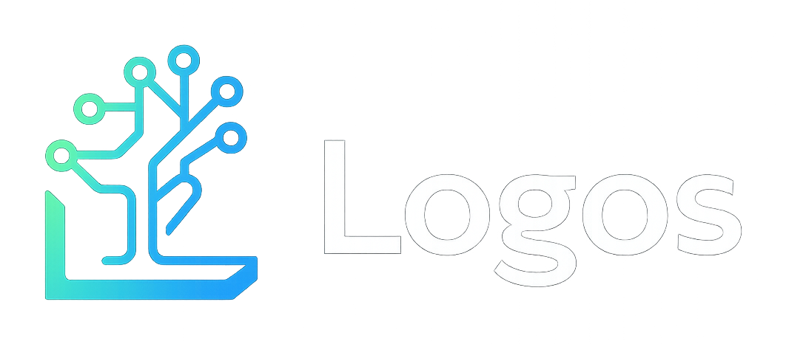

<p align="center">
  
</p>

# Logos v2

Logos is a small, self-hosted home for personal AI agents. Version 2 is built for exactly two
people, Greg and Béré, and exactly three agents: one private agent each, plus a shared
Household agent.

- **Agents** are unmodified upstream [hermes-agent](https://github.com/NousResearch/hermes-agent)
  v0.23.1, each running in its own [OpenShell](https://github.com/NVIDIA/OpenShell) 0.1.8
  sandbox on the Docker driver.
- **Brains** are plain markdown vaults, one per agent, kept on a Docker volume. The agent
  writes its brain; its person can read and edit it in Obsidian. Containers are disposable,
  the brain is what lasts.
- **Logos** itself is a thin control plane: a gateway with two logins, a chat page, an agents
  page and a live activity view.

The full plan and backlog are in the spec:
https://claude.ai/artifact/JpSGvsY25zM7VHPdce6v6P

> **Status: rebuild in progress on the `v2` branch.** Logos v1 (final release v1.0.20, tag
> `v1-final`) was a much larger multi-user platform. Most of it has been removed. Its planning
> documents are kept in [docs/archive/v1/](docs/archive/v1/) for history only.

## What exists today

| Piece | Where | State |
| --- | --- | --- |
| Agent image | [infra/agent-image/](infra/agent-image/) | Upstream hermes pinned by digest, plus a thin layer and a sandbox policy |
| OpenShell setup | [infra/openshell/](infra/openshell/) | Gateway config and provider definitions for OpenShell 0.1.8 |
| Agent lifecycle | [scripts/logos-agent](scripts/logos-agent), [agents/](agents/) | `up`, `down`, `status`, `exec` from `agents/<name>.yaml` |
| Model gateway | [scripts/logos-models](scripts/logos-models), [docs/model-gateway.md](docs/model-gateway.md) | One container all model calls go through: a key and a hard monthly budget per agent, paid provider keys kept out of the sandboxes |
| Noticeboard | [gateway/noticeboard.py](gateway/noticeboard.py), [docs/noticeboard.md](docs/noticeboard.md) | The only channel between agents: a fixed menu of message kinds, the recipient always decides, limits and a full log |
| Voice | [gateway/voice.py](gateway/voice.py), [docs/voice.md](docs/voice.md) | One speech-to-text service for every agent: a voice note becomes text, nothing is kept |
| Brain rules | [infra/brain-template/](infra/brain-template/), [infra/agent-jobs/](infra/agent-jobs/) | Vault layout, nightly consolidation, brain index, git history inside the vault |
| Brain sync | [scripts/logos-sync](scripts/logos-sync), [docs/brain-sync.md](docs/brain-sync.md) | One Syncthing container; each brain is a folder shared only with its own devices and opens as an Obsidian vault |
| Gateway and web chat | [gateway/](gateway/), [logos_cli/](logos_cli/) | Login, account setup, trimmed dashboard. With `LOGOS_SANDBOX_BACKEND=openshell` it lists the defined agents and chats with them ([docs/architecture/web-chat.md](docs/architecture/web-chat.md)) |
| Checks | [evals/](evals/) | Brain-write and brain-rule checks that run inside a sandbox |

## What is not built yet

- The gateway talks to the agents only when started with `LOGOS_SANDBOX_BACKEND=openshell`
  (put it in `~/.logos/.env`). Without it the dashboard shows empty states and chat returns
  `503 no_agents_running`.
- Three agents are defined (`agents/greg.yaml`, `agents/bere.yaml`, `agents/household.yaml`), plus
  `agents/bench.yaml` for benchmarking and `agents/dev.yaml` for a development machine (its own
  Telegram bot, never started in production). They can exchange messages but do not yet check the
  noticeboard on their own.
- There is no brain browser in the dashboard yet.
- Web conversations and Telegram conversations are separate sessions of the same agent. They
  share its memory and brain, not the message history.
- The agent image is built locally. Nothing is published to a registry.

## Quick start

You need a Linux host with Docker Engine 28 or later, systemd and Python 3.11 or later.

1. **Install and configure OpenShell 0.1.8.** Follow
   [infra/openshell/README.md](infra/openshell/README.md).
2. **Build the agent image.** Follow [infra/agent-image/README.md](infra/agent-image/README.md):

   ```shell
   docker build -t logos-agent:0.23.1 infra/agent-image
   ```

3. **Create an agent.** Each agent is described by `agents/<name>.yaml`. Machine-specific
   values, such as Telegram user IDs, go in an untracked `agents/<name>.local.yaml`.

   ```shell
   export LOGOS_TELEGRAM_BOT_TOKEN=...   # first `up` only; then kept in the agent's home volume
   scripts/logos-agent up greg
   scripts/logos-agent status greg
   ```

4. **Open the brain in Obsidian** (optional). Follow [docs/brain-sync.md](docs/brain-sync.md):

   ```shell
   scripts/logos-sync up greg
   ```

5. **Run the gateway shell** (optional; it does not reach the agents yet):

   ```shell
   python3 -m venv venv && . venv/bin/activate
   pip install -e ".[all,dev]"
   logos doctor                # checks Python, Docker, OpenShell and ~/.logos
   logos gateway run           # http://localhost:8091, first visit creates the admin account
   ```

   Gateway settings are `LOGOS_*` environment variables; see [.env.example](.env.example).
   Its state lives in `~/.logos` (override with `LOGOS_HOME`).

## Repository layout

```
agents/           agent definitions (one YAML per agent)
infra/            agent image, OpenShell config, brain template, in-sandbox jobs
scripts/          logos-agent (lifecycle), logos-sync (Syncthing)
souls/            persona files an agent definition can point at
gateway/          the Logos gateway: HTTP API, auth, dashboard HTML
logos_cli/        the `logos` command (gateway control, doctor)
evals/            checks that run against a live sandbox
tests/            pytest suite
docs/             ADRs, architecture notes, brain sync guide, v1 archive
```

More detail is in [docs/project/REPO_STRUCTURE.md](docs/project/REPO_STRUCTURE.md).
Design decisions are recorded in [docs/adr/](docs/adr/).

## Tests

```shell
python -m pytest -q tests
```

CI runs the same suite on pushes and pull requests to `main` and `v2`
([.github/workflows/tests.yml](.github/workflows/tests.yml)). See
[CONTRIBUTING.md](CONTRIBUTING.md) for how to work on the repo.

## License

MIT. See [LICENSE](LICENSE).

## Thanks

This project stands on other people's open-source work:

- **[Nous Research / hermes-agent](https://github.com/NousResearch/hermes-agent)**: the agent
  runtime. Logos runs it unchanged inside each sandbox.
- **[NVIDIA OpenShell](https://github.com/NVIDIA/OpenShell)**: the sandbox runtime, with
  filesystem and network policy per agent.
- **[Anthropic / Claude](https://www.anthropic.com)**: Claude wrote a large part of the
  gateway, the tooling and this documentation.
- **[Syncthing](https://syncthing.net)** and **[Obsidian](https://obsidian.md)**: how a brain
  reaches its person's devices and how they read it.
- **[LM Studio](https://lmstudio.ai)**: local model serving for the agents.
- **[aiohttp](https://github.com/aio-libs/aiohttp)**, **[Alpine.js](https://alpinejs.dev)**,
  **[Tailwind CSS](https://tailwindcss.com)** and **[marked.js](https://github.com/markedjs/marked)**:
  the gateway and its dashboard.
- **[python-telegram-bot](https://github.com/python-telegram-bot/python-telegram-bot)** and
  **[SQLite](https://www.sqlite.org)**.
